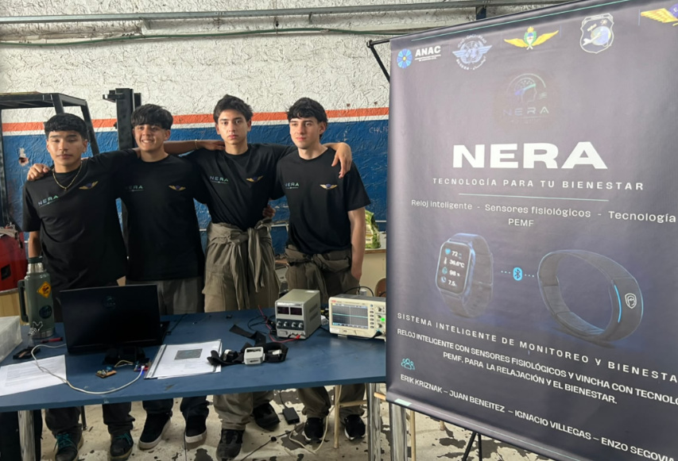
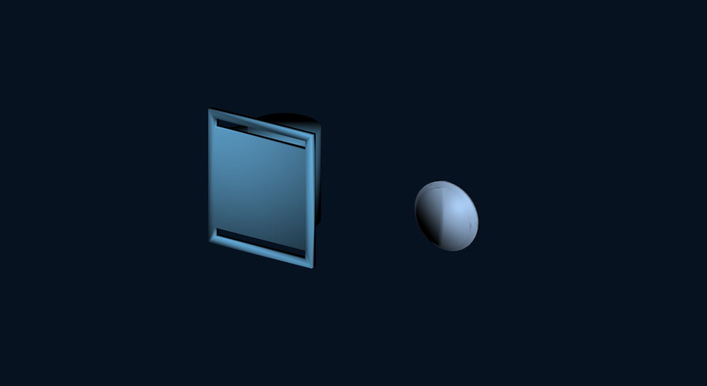
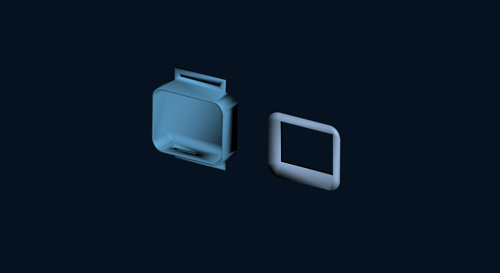
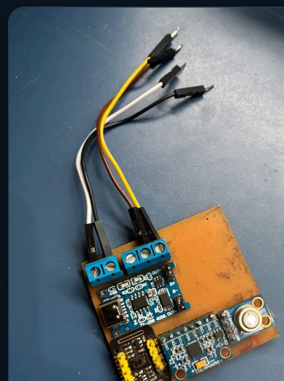
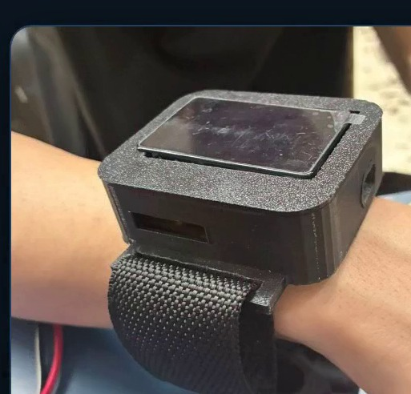

# N.E.R.A.

**Neuro Estimulación y Relajación Asistida**

Somos estudiantes de 7.º año de Aviónica de la **E.E.S.T. N.º 7 «Taller Regional Quilmes» (IMPA)**. Durante 2026 desarrollamos NERA, un proyecto que combina electrónica, programación, investigación y fabricación de piezas en 3D.

[Repositorio oficial](https://github.com/impatrq/NERA) · [Tablero de trabajo](https://trello.com/b/I9nTunkC/kanban-2026722cnera)

## ¿Qué es NERA?

La idea surgió al buscar una herramienta tecnológica que pudiera acompañar a personas en situaciones de estrés o ansiedad. Construimos un prototipo portátil con **dos dispositivos principales: un reloj y una vincha**. Una aplicación móvil complementa el sistema y permite consultar la información del reloj.

También investigamos el uso de campos electromagnéticos pulsados (PEMF) de baja frecuencia. Esta parte del proyecto sigue siendo experimental; no hemos demostrado efectos terapéuticos ni validado el dispositivo para su uso sobre personas.

## ¿Cómo funciona?

El **reloj** reúne las mediciones de sus sensores y las muestra en una pantalla táctil. Mediante **Bluetooth Low Energy (BLE)** puede compartir datos con la aplicación del celular, donde se consultan las mediciones, el historial y algunas preferencias.

El reloj y la **vincha** se comunican mediante **ESP-NOW**. Ya probamos el envío de mensajes y sus confirmaciones. La vincha incorpora una controladora y bobinas; el accionamiento automático seguro de esas bobinas a partir de las mediciones todavía requiere pruebas y correcciones.

## Nuestro proceso de desarrollo

Trabajamos en el diseño de las placas, la programación, la fabricación de bobinas, las carcasas impresas en 3D y el armado del prototipo. Estas son algunas imágenes del trabajo realizado:

| Diseño de la placa controladora | Modelado de las bobinas |
| :---: | :---: |
|  |  |
| **Carcasa del reloj** | **Armado de la electrónica** |
|  |  |
| **Reloj durante las pruebas** | **Aplicación móvil** |
|  |  |

Los modelos, circuitos y fotografías corresponden a distintas etapas del proyecto. Los archivos de diseño y fabricación están disponibles en las carpetas [`circuitos`](circuitos/) y [`mechanical`](mechanical/).

## Componentes del sistema

### Reloj NERA

Utilizamos un **ESP32-S3** con pantalla táctil de 240 × 320 píxeles. El firmware se desarrolló con C/C++, ESP-IDF, FreeRTOS y LVGL.

| Componente | Función |
| --- | --- |
| ESP32-S3 | Procesamiento, pantalla y comunicaciones inalámbricas. |
| MAX30102 | Señal óptica para estimar pulso y SpO₂. |
| MLX90614 | Medición infrarroja de temperatura de objeto. |
| MPU6050 | Detección de movimiento con acelerómetro y giroscopio. |

[Ver firmware del reloj](firmware/Codigo%20Reloj/) · [Guía del código](firmware/Codigo%20Reloj/LEER_PRIMERO.md)

### Vincha NERA

La vincha utiliza un **ESP32-C3**, una placa controladora, una etapa de potencia y bobinas hechas con cobre esmaltado. Diseñamos diferentes versiones de soportes y carcasas para alojar los componentes.

Estudiamos frecuencias de **10 a 30 Hz**; el firmware publicado incluye una prueba de señal de **15 Hz sin bobinas conectadas**. Esa prueba no equivale a validar la corriente, el campo magnético o la seguridad de la etapa de potencia.

[Ver firmware de la vincha](firmware/Codigo%20Vincha/) · [Prueba de 15 Hz](firmware/Codigo%20Vincha/docs/PRUEBA_GPIO5_15HZ.md)

### Aplicación móvil

La aplicación está desarrollada con **Flutter y Dart**. Tiene las secciones Inicio, Salud, Apoyo y Perfil, y permite acceder a las mediciones e historial del reloj a través de BLE. Incluye funciones de respiración y configuración de preferencias. El envío automático de avisos a contactos aún no está implementado.

[Ver aplicación](firmware/Codigo%20Aplicacion/) · [Organización del código](firmware/Codigo%20Aplicacion/GUIA_CODIGO.md)

## Avances del proyecto

Durante el año fabricamos y probamos las placas y carcasas, desarrollamos la interfaz del reloj e integramos la aplicación. Las pruebas documentadas incluyen comunicación BLE entre reloj y celular, historial de mediciones y comunicación ESP-NOW entre los microcontroladores.

Todavía quedan tareas de integración, alimentación, estabilidad de sensores y validación eléctrica de la vincha. La lógica propuesta de activación por combinación de variables es un objetivo de desarrollo; las reglas documentadas en el firmware actual son pruebas independientes de pulso y temperatura.

## Integrantes

| Integrante | Área principal |
| --- | --- |
| **Erik Kriznjak** | Programación del reloj, aplicación móvil y comunicaciones. |
| **Juan Cruz Beneitez** | Electrónica, sensores, PCB, soldadura y pruebas. |
| **Ignacio Villegas** | Diseño CAD, impresión 3D, carcasas y armado. |
| **Enzo Segovia** | Investigación de componentes, parámetros fisiológicos y tecnología PEMF. |

Los cuatro participamos en la integración, las correcciones y la exposición del proyecto.

## Archivos del proyecto

| Carpeta | Contenido |
| --- | --- |
| [`circuitos/`](circuitos/) | Esquemáticos y PCB de KiCad. |
| [`mechanical/`](mechanical/) | Modelos de carcasas y archivos STL. |
| [`firmware/`](firmware/) | Código del reloj, la vincha y la aplicación. |
| [`docs/`](docs/) | Manuales, fichas de componentes e imágenes. |

Las instrucciones para compilar los distintos programas están en el [README de firmware](firmware/README.md).

---

**Proyecto NERA · 7.º año Aviónica · E.E.S.T. N.º 7, Quilmes · 2026**
