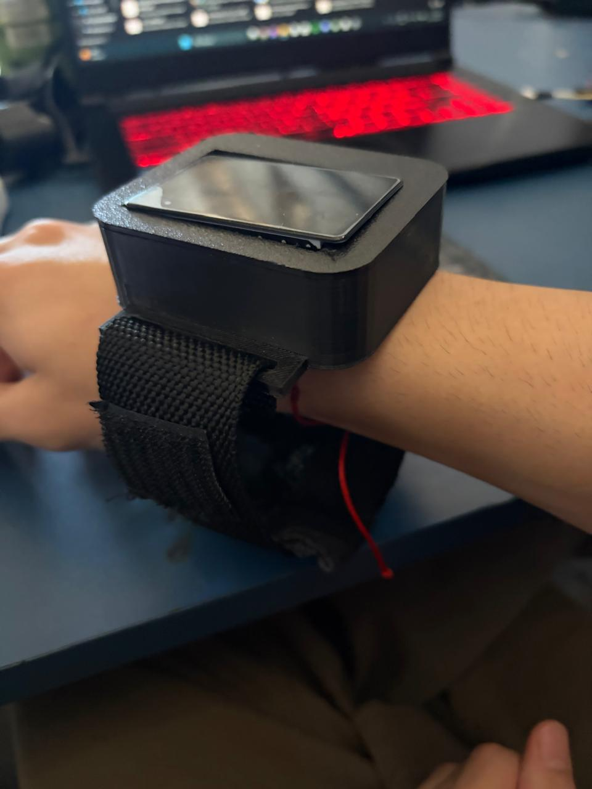
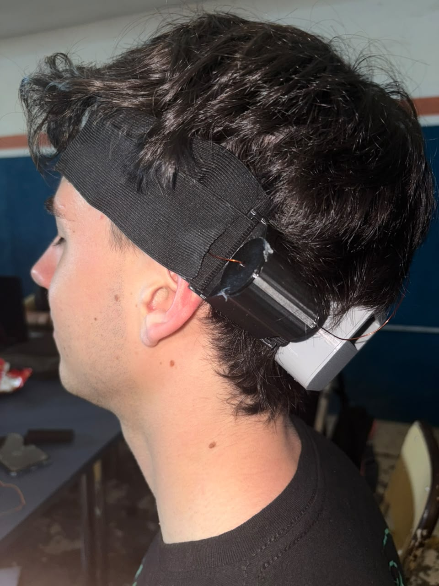
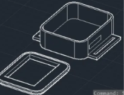
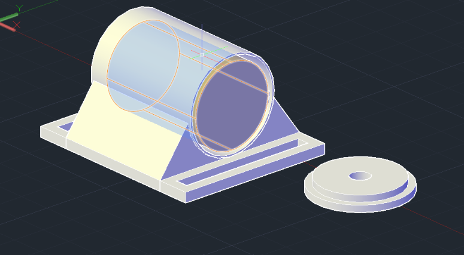
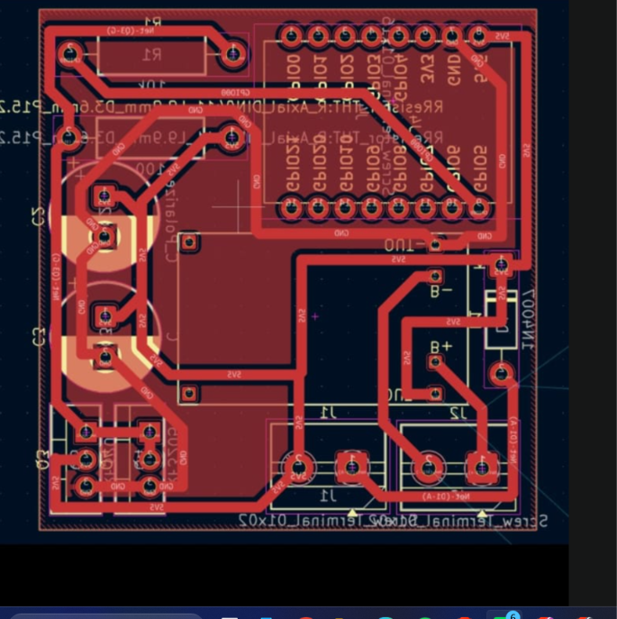

# N.E.R.A.

**Neuro Estimulación y Relajación Asistida**

  

Somos estudiantes de 7.º año de Aviónica de la **Escuela de Educación Secundaria Técnica N.º 7 «Taller Regional Quilmes» (IMPA)**. Durante 2026 desarrollamos NERA, un proyecto que combina investigación, electrónica, programación y diseño 3D.

  

[Repositorio oficial](https://github.com/impatrq/NERA) · [Seguimiento en Trello](https://trello.com/b/I9nTunkC/kanban-2026722cnera)

## ¿Qué es NERA?

NERA surgió con la idea de desarrollar una herramienta tecnológica que pueda acompañar a personas en situaciones de estrés o ansiedad. Construimos un prototipo portátil con **dos dispositivos principales: un reloj y una vincha**. Una aplicación móvil complementa el sistema y permite consultar las mediciones.

También investigamos los campos electromagnéticos pulsados (**PEMF**) de baja frecuencia y sus posibles aplicaciones. Esta parte sigue siendo experimental: todavía no demostramos efectos terapéuticos ni validamos la seguridad del dispositivo para su aplicación sobre personas.

## ¿Cómo funciona?

El **reloj** utiliza un ESP32-S3 para recopilar información de los sensores, procesarla y mostrarla en su pantalla táctil. Mediante **Bluetooth Low Energy (BLE)** envía lecturas a la aplicación móvil, donde se pueden consultar datos, historial y preferencias.

El reloj también se comunica con la **vincha**, controlada por un ESP32-C3, mediante **ESP-NOW**. Probamos el intercambio de mensajes, alertas de laboratorio y confirmaciones de recepción. La vincha contiene bobinas y una electrónica de control; el accionamiento seguro y automático de las bobinas a partir de las mediciones todavía requiere validación eléctrica.

## Prototipos reales

Estas son las versiones físicas del reloj y la vincha que construimos, ajustamos y presentamos durante el desarrollo del proyecto.

| Reloj NERA | Vincha NERA |
|:---:|:---:|
|  |  |
| **Reloj con carcasa impresa en 3D** | **Vincha con las carcasas de las bobinas** |

## Modelos actuales en CAD

Estos son algunos de los diseños actuales de la estructura del reloj y de la vincha hechos para adaptar el prototipo a los componentes reales.

| Modelo del reloj | Modelo de la vincha |
|:---:|:---:|
|  |  |
| **Carcasa del reloj** | **Soporte de la vincha y bobina** |

## PCB y proceso electrónico

Durante el proyecto diseñamos placas, corregimos pistas, soldamos componentes y probamos módulos reales para verificar conexiones y funcionamiento.

| Diseño PCB | Placa en pruebas |
|:---:|:---:|
|  |  |
| **Diseño de la PCB** | **Placa de sensores armada** |

## Componentes del sistema

### Reloj inteligente

El reloj utiliza un **ESP32-S3** con pantalla táctil de **240 × 320 píxeles**. El firmware se desarrolló con **C/C++, ESP-IDF, FreeRTOS y LVGL**.

| Componente | Función |
| --- | --- |
| **ESP32-S3** | Procesamiento, pantalla y comunicaciones inalámbricas. |
| **MAX30102** | Señal óptica para estimar frecuencia cardíaca y SpO₂. |
| **MLX90614** | Medición infrarroja de temperatura de objeto. |
| **MPU6050** | Registro de movimiento mediante acelerómetro y giroscopio. |

Las estimaciones de pulso y SpO₂ dependen de lecturas válidas. La temperatura infrarroja registrada no representa directamente la temperatura corporal central.

[Ver firmware del reloj](firmware/Codigo%20Reloj/) · [Guía técnica](firmware/Codigo%20Reloj/LEER_PRIMERO.md)

### Vincha experimental

La vincha incorpora un **ESP32-C3**, una placa controladora, una etapa de potencia y bobinas realizadas con cobre esmaltado. Diseñamos y fabricamos distintas versiones de las carcasas para montar los componentes.

Investigamos frecuencias entre **10 y 30 Hz**. El firmware publicado contiene una prueba de señal a **15 Hz con las bobinas desconectadas**. Esta prueba permite comprobar la salida eléctrica, pero no demuestra la seguridad ni la eficacia de la estimulación.

[Ver firmware de la vincha](firmware/Codigo%20Vincha/) · [Documentación de la prueba de 15 Hz](firmware/Codigo%20Vincha/docs/PRUEBA_GPIO5_15HZ.md)

### Aplicación móvil

La aplicación fue desarrollada con **Flutter y Dart**. Cuenta con las secciones **Inicio, Salud, Apoyo y Perfil**. Permite consultar mediciones e historial del reloj por BLE, configurar preferencias y utilizar funciones de respiración. La red de apoyo está contemplada en la interfaz; el envío automático de avisos a contactos todavía no se encuentra implementado.

[Ver aplicación](firmware/Codigo%20Aplicacion/) · [Mapa del código](firmware/Codigo%20Aplicacion/GUIA_CODIGO.md)

| Pantalla de inicio | Consulta de mediciones |
| :---: | :---: |
|  |  |
| **Inicio** | **Salud** |

## Presupuesto estimado

El costo estimado de los materiales electrónicos relevados es de **$156.978,12 ARS**. Son **precios de referencia**, no gastos efectivamente comprobados.

| Componente | Cantidad | Subtotal (ARS) |
| --- | :---: | ---: |
| ESP32-S3 + pantalla | 1 | $48.510 |
| ESP32-C3 SuperMini | 1 | $7.999 |
| MAX30102 | 1 | $7.860 |
| MLX90614 | 1 | $24.459 |
| MPU6050 | 1 | $6.149 |
| MOSFET IRFZ44N | 2 | $4.398 |
| TP4056 (módulo) | 1 | $3.499 |
| Baterías 18650 | 2 | $9.213,16 |
| Baterías LQ-S1 (pack de 2) | 1 | $14.418,97 |
| Cobre esmaltado (250 g) | 1 | $19.123,99 |
| LM2596 | 1 | $4.999 |
| Portabaterías | 1 | $6.349 |
| **Total estimado** |  | **$156.978,12** |

Este valor **no incluye** fabricación de PCB, resistencias, capacitores, diodos, cables, impresión 3D, tornillos ni otros materiales. Algunas cantidades fueron estimadas a partir de los circuitos y no está confirmado que se hayan comprado todos los elementos de la lista.

## Avances y estado actual

A lo largo del año fabricamos y probamos las placas y carcasas, desarrollamos la interfaz del reloj e integramos la aplicación. Las pruebas documentadas incluyen comunicación **BLE** entre el reloj y el teléfono, sincronización e historial de mediciones y comunicación **ESP-NOW** entre los dos microcontroladores.

El prototipo sigue en desarrollo. Quedan pendientes ajustes en la alimentación, estabilidad de sensores, validación del circuito de potencia y funcionamiento integrado. La activación mediante combinación de variables es una idea de evolución del sistema; en el firmware documentado actualmente se usan reglas de laboratorio independientes para pulso y temperatura. **NERA no es un sistema médico validado para diagnosticar o tratar estrés o ansiedad.**

## Integrantes

| Integrante | Área principal |
| --- | --- |
| **Erik Kriznjak** | Programación del reloj, aplicación móvil, comunicaciones e integración. |
| **Juan Cruz Beneitez** | Electrónica, sensores, PCB, soldadura y pruebas de los circuitos. |
| **Ignacio Villegas** | Diseño CAD, impresión 3D, carcasas y armado de los dispositivos. |
| **Enzo Segovia** | Investigación de componentes, parámetros fisiológicos y tecnología PEMF. |

Los cuatro participamos en las pruebas, correcciones y exposición del prototipo.

## Archivos del proyecto

| Carpeta | Contenido |
| --- | --- |
| [`circuitos/`](circuitos/) | Esquemáticos y diseños de placas PCB. |
| [`mechanical/`](mechanical/) | Modelos 3D, carcasas y archivos STL de fabricación. |
| [`firmware/`](firmware/) | Código del reloj, la vincha y la aplicación móvil. |
| [`docs/`](docs/) | Manuales, documentación técnica e imágenes. |

Para acceder al código y a sus instrucciones de compilación: [README de firmware](firmware/README.md).

---

**Proyecto NERA · 7.º año de Aviónica · E.E.S.T. N.º 7 · Quilmes · 2026**
